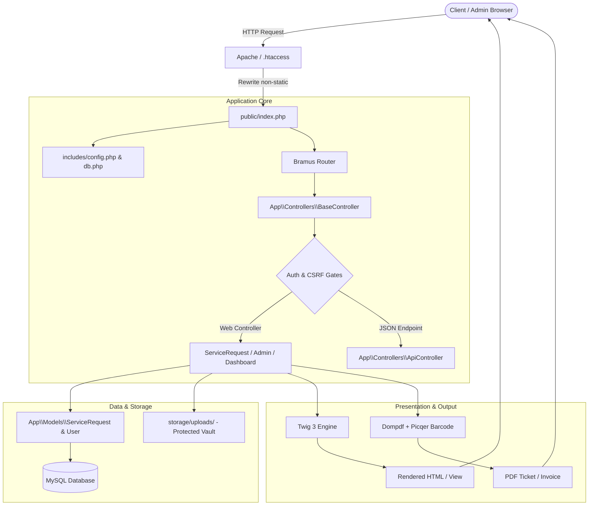

# 🛠️ Gadget Clinic — Device Repair & Diagnostics Management Platform

[](https://www.php.net/)
[](https://www.php-fig.org/psr/psr-4/)
[](https://twig.symfony.com/)
[](https://www.mysql.com/)
[](LICENSE)

**Gadget Clinic** is a full-featured, production-ready appointment scheduling, diagnostics tracking, and customer drop-off management platform tailored for electronics and repair service centers. 

Built with a **handcrafted PHP MVC architecture** rather than an off-the-shelf monolithic framework, this project demonstrates deep mastery of core web engineering: custom routing, PSR-4 dependency autoloading, secure file streaming, transactional state workflows, and hardened session security.

---

## 🏛️ Architectural Rationale: Why Custom MVC?

While heavy frameworks like Laravel or Symfony provide out-of-the-box scaffolding, choosing a **bespoke PSR-4 MVC stack** offers distinct engineering advantages:

1. **Under-the-Hood Understanding**: Every request lifecycle — from Apache URL rewrite to Router resolution, BaseController authorization gates, Twig rendering, and PDO parameter binding — is explicitly wired and transparent.
2. **Minimal Resource Overhead**: Operates with near-zero memory footprint compared to large framework runtime containers, making it exceptionally fast on shared hosting, VPS, or lightweight containers.
3. **Decoupled Components**: Best-in-class individual libraries (`twig/twig`, `bramus/router`, `dompdf/dompdf`, `picqer/php-barcode-generator`, `phpmailer/phpmailer`) are composed cleanly via Composer without vendor lock-in.

---

## 📐 High-Level Architecture



---

## ✨ Key Features

### 👤 Customer Experience (Client Portal)
- **Interactive Booking Flow**: Smart booking calendar with instant schedule conflict checking and shop blackout date avoidance.
- **Hardware Document Upload**: Securely attach photos or warranty invoices (JPG, PNG, PDF) during booking.
- **Drop-off Pass Generation**: Instant PDF verification stub featuring an authentic, scannable **Code 128 barcode** and booking reference.
- **Quote Review & Decisions**: Review technician repair estimates, approve or decline with a single click.
- **Digital Invoices**: Automatic PDF invoice generation for completed repairs.

### 🛡️ Technician & Admin Command Deck
- **Live Lifecycle Pipeline**: Seamlessly transition repairs through status stages (`pending` → `confirmed` → `in_progress` → `for_pickup` → `completed` → `cancelled`).
- **Interactive Quoting Engine**: Issue itemized repair quotations directly to customer dashboards with automated email dispatch.
- **Blackout Management**: Dynamically configure store holidays or maintenance days to instantly block customer slots.
- **Background Live Polling**: Automatically polls for incoming drop-off requests without page refreshes.

---

## 🔒 Security Hardening

- **Protected Storage Vault**: Uploaded customer documents live strictly outside the webroot (`storage/uploads/`). Access is gated through `viewDocument()` which enforces user session ownership and admin authorization.
- **Rate-Limiting**: Sliding-window rate limiter prevents booking automated spam or bot denial-of-service attempts.
- **CSRF Token Rotation**: Cryptographically secure tokens (`random_bytes(32)`) rotated upon successful state-changing operations to eliminate token fixation.
- **Hardened Sessions**: Enforced `HttpOnly`, `SameSite=Lax`, and dynamic `Secure` cookies for production HTTPS environments.
- **Zero Information Leakage**: Production database exceptions are masked with safe user-facing error messages while detailed diagnostics are written to the server error log.
- **SQL Injection Defense**: Strict PDO parameterized queries with `PDO::ATTR_EMULATE_PREPARES => false`.

---

## 📂 Project Structure

```
gadget_clinic/
├── app/
│   ├── Controllers/          # Request handling & application logic
│   │   ├── AdminController.php
│   │   ├── ApiController.php
│   │   ├── AuthController.php
│   │   ├── BaseController.php       # Shared auth, rate-limiting & CSRF logic
│   │   ├── DashboardController.php
│   │   ├── HomeController.php
│   │   └── ServiceRequestController.php
│   └── Models/               # PDO database persistence layer
│       ├── BaseModel.php
│       ├── BlackoutDate.php
│       ├── ServiceRequest.php
│       └── User.php
├── includes/                 # Core bootstrap, DB connection & helpers
│   ├── config.php            # Environment loading & session hardening
│   ├── db.php                # PDO singleton connection
│   ├── email_helper.php      # PHPMailer SMTP integration
│   ├── twig.php              # Twig template engine bootstrap
│   └── errors/               # Custom HTTP error pages (403, 404)
├── public/                   # Public document root
│   ├── assets/               # CSS, JS, brand images
│   ├── index.php             # Front controller & route definitions
│   └── .htaccess             # Apache rewrite rules
├── scripts/                  # Scheduled tasks & maintenance utilities
│   ├── auto_cancel_noshows.php # Daily cron job for abandoned bookings
│   └── create_table.php
├── storage/                  # Protected application storage
│   └── uploads/              # Customer document uploads (gated access)
├── templates/                # Twig view templates
│   ├── admin.twig
│   ├── dashboard.twig
│   └── index.twig
├── .env.example              # Template configuration file
├── composer.json             # PHP dependencies & PSR-4 autoloading
└── crontab_setup.txt         # Server cron configuration guide
```

---

## 🚀 Getting Started

### Prerequisites
- **PHP** >= 8.1 (with `pdo_mysql`, `curl`, `mbstring`, `fileinfo` extensions enabled)
- **Composer** (Dependency Manager)
- **MySQL** / MariaDB
- **Apache** with `mod_rewrite` enabled

### Installation

1. **Clone the repository:**
   ```bash
   git clone https://github.com/your-username/gadget-clinic.git
   cd gadget-clinic
   ```

2. **Install PHP dependencies:**
   ```bash
   composer install
   ```

3. **Configure Environment:**
   ```bash
   cp .env.example .env
   ```
   Open `.env` and fill in your database credentials, Google OAuth keys (optional for local dev), and SMTP parameters:
   ```ini
   APP_ENV=local
   APP_URL=http://localhost/gadget_clinic/public
   APP_TIMEZONE=Asia/Manila

   DB_HOST=localhost
   DB_NAME=appointment_system
   DB_USER=root
   DB_PASS=
   ```

4. **Initialize Database:**
   Import `techfix_dump.sql` (or run your initial schema) into your MySQL database:
   ```bash
   mysql -u root -p appointment_system < techfix_dump.sql
   ```

5. **Ensure Correct Storage Permissions:**
   ```bash
   chmod -R 775 storage/uploads
   ```

6. **Serve the Application:**
   Point your Apache VirtualHost `DocumentRoot` to `gadget_clinic/public`, or access via XAMPP at:
   ```
   http://localhost/gadget_clinic/public/
   ```

---

## ⏰ Automated Background Jobs

The platform includes automated maintenance scripts designed to run on a Linux server cron.

To set up the nightly no-show cleaner (cancels pending/confirmed requests exceeding 12 hours past schedule):
```bash
crontab -e
```
Add the following entry:
```cron
0 0 * * * php /path/to/gadget_clinic/scripts/auto_cancel_noshows.php >> /path/to/gadget_clinic/scripts/cron.log 2>&1
```

---

## 🛠️ Stack & Dependencies

| Layer | Package / Tool | Purpose |
|---|---|---|
| **Routing** | [`bramus/router`](https://github.com/bramus/router) | Lightweight HTTP request routing |
| **Views** | [`twig/twig`](https://twig.symfony.com/) | Secure, compiled view templating |
| **PDF Generation** | [`dompdf/dompdf`](https://github.com/dompdf/dompdf) | Converts HTML/CSS to vector PDFs |
| **Barcodes** | [`picqer/php-barcode-generator`](https://github.com/picqer/php-barcode-generator) | Real Code 128 barcodes for drop-off passes |
| **Mail** | [`phpmailer/phpmailer`](https://github.com/PHPMailer/PHPMailer) | Transactional customer notifications |
| **Auth** | [`google/apiclient`](https://github.com/googleapis/google-api-php-client) | Google OAuth 2.0 single sign-on |
| **Frontend** | Vanilla JS + DataTables + Flatpickr | Reactive UI with zero framework overhead |

---

## 📄 License
This project is open-source under the [MIT License](LICENSE).
